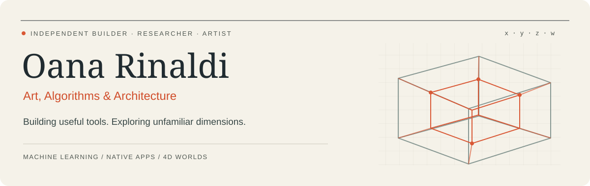
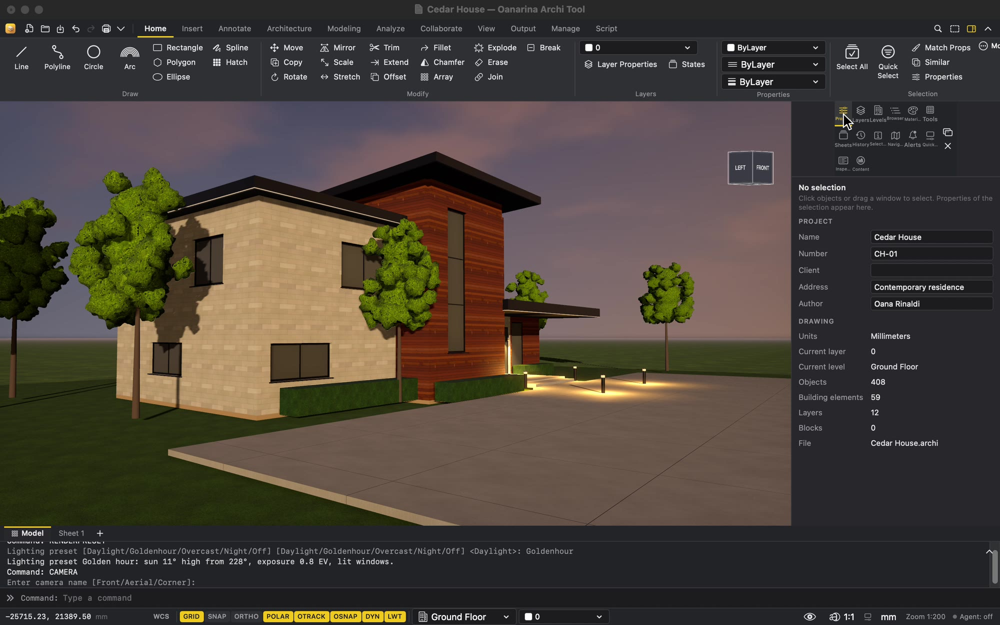
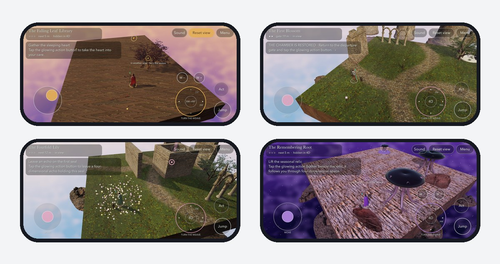
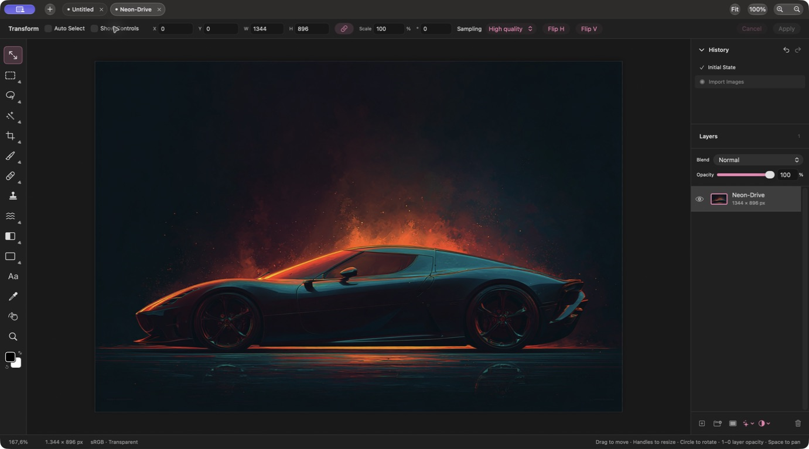

  
  
  

### Hi, I'm Oana

I'm a **machine learning engineer, independent app developer, architect and artist**. I build tools for creating, learning and exploring space — from architectural drafting and native creative apps to games that make four dimensions tangible.

- **Machine learning:** ML and deep learning systems for time series and tabular data, experimentation, deployment and monitoring.
- **Engineering:** six years in Java backend development, building gaming microservices with Spring Boot, Kafka, MongoDB, Docker and Kubernetes.
- **Research & teaching:** PhD student at POLITEHNICA Bucharest, exploring *4D Spatial Mechanics in Game Design*, and university teaching assistant in Algorithms and Data Structures.

### Selected things I've built

<table>
<tr>
<td width="50%" valign="top">

<h3>Oanarina Archi Tool</h3>

Architectural drafting, BIM, 3D modelling and rendering, with a command line and scripting interface for AI agents.

<strong>Free &amp; open source · Mac &amp; Windows</strong>

<a href="https://github.com/oanaunc/archi_tool">Source code</a> · <a href="https://oanarinaldi.com/archi-tool.html">Explore &amp; download →</a>

</td>
<td width="50%" valign="top">

<h3>Aetherfold 4D: The Lost Weave</h3>

A puzzle adventure through four spatial dimensions, bringing geometry, architecture and visual storytelling into a playable world.

<strong>4D geometry · Game design · Spatial thinking</strong>

<a href="https://aetherfold4d.com">Explore the game →</a> · <a href="https://apps.apple.com/us/app/aetherfold-4d-the-lost-weave/id6812213342">App Store</a>

</td>
</tr>
<tr>
<td width="50%" valign="top">

<h3>Oanarina Photo Editor</h3>

A native Mac studio for layers, retouching, compositing, painting and animation. Editing and project files stay on your Mac.

<strong>Free · Native macOS · Creative tools</strong>

<a href="https://oanarinaldi.com/photo-editor.html">Explore &amp; download →</a>

</td>
<td width="50%" valign="top">

<h3>AI Architecture Apps</h3>

Tools for exploring floor plans, architectural renders and cinematic videos from plans, sketches and room photos.

<strong>Applied AI · Architecture · iOS &amp; Android</strong>

<a href="https://oanarinaldi.com/architectureapps.html">Explore the collection →</a>

</td>
</tr>
</table>

### Explore the code & the fourth dimension

| Project | What you'll find | Try it |
| --- | --- | --- |
| [4D Chess](https://github.com/oanaunc/4d_chess) | A research-based chess engine and interactive visualization on a four-dimensional board. JavaScript & Three.js. | [Play in your browser](https://oanarinaldi.com/4d_chess/) |
| [Magic Cube 4D](https://github.com/oanaunc/rubik_4D) | A 3×3×3×3 hypercube puzzle, 4D projection and reproducible mathematical experiments. | [Explore the hypercube](https://oanarinaldi.com/rubik_4D/) |
| [Draw Through](https://github.com/oanaunc/draw_through) | A native iPhone and iPad drawing field school with workshops, references and PencilKit practice. | [Browse all my apps](https://oanarinaldi.com/apps.html) |
| [PyTorch Stable Diffusion](https://github.com/oanaunc/pytorch_stable_diffusion) | A from-scratch Stable Diffusion implementation and model experiments. | [Read the code](https://github.com/oanaunc/pytorch_stable_diffusion) |

### Technologies I work with

**Machine learning & data**

Pandas · NumPy · Apache Spark · SQL

**Backend & infrastructure**

**Apps & interactive experiences**

### Research, writing & creative work

- [A Mathematical Framework for Four-Dimensional Chess](https://doi.org/10.3390/appliedmath6030048) — *AppliedMath*, 2026, with Costin-Gabriel Chiru.
- *Beyond Euclidean Play: Integrating 4D Geometry into Game Mechanics and Simulation Systems* — GAME-ON 2025. [Research & background](https://oanarinaldi.com/itbio.html).
- [Art of Coding](https://artofcoding.blog/) — programming tutorials and ideas.
- [Art](https://oanarinaldi.com/artbio.html) · [Architecture](https://oanarinaldi.com/architecture.html) · [Photography](https://oanarinaldi.com/photography.html) — the other sides of my practice.

<strong>Education & certifications</strong>

- PhD studies in Automation and Computers, POLITEHNICA Bucharest (2024–2028).
- MSc in Data Science and Artificial Intelligence; BSc in Computer Science, Titu Maiorescu University.
- Bachelor's and Master's studies in Architecture, Ion Mincu University of Architecture and Urbanism.
- Oracle Certified Professional: Java SE 11 Developer.
- Microsoft MCSA: SQL 2016 Database Development; Microsoft certifications in C# and HTML5/JavaScript/CSS3.

---

**Let's connect:** [Portfolio](https://oanarinaldi.com) · [Contact](https://oanarinaldi.com/index.html#contact) · [App Store](https://apps.apple.com/us/developer/oana-rinaldi/id1709880614)
